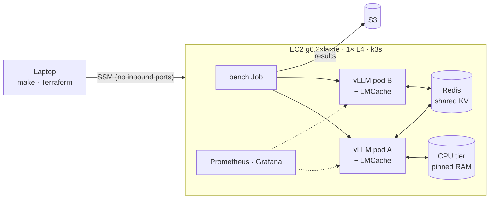

# KV cache tiering on one GPU

A small, reproducible measurement of how much tiered and shared KV cache cuts time-to-first-token (TTFT) in LLM inference. It runs on one AWS GPU instance (NVIDIA L4) with Kubernetes, vLLM and LMCache, and is set up and torn down by `make`.

**Headline:** when a long document's KV cache has been evicted from GPU memory, a CPU memory tier brings it back in **68 ms instead of recomputing it in 1,449 ms (21× faster)**, and cuts total prefill compute for the workload by **half**.


**→ Read the full study: [docs/REPORT.md](docs/REPORT.md)**: method, per-scenario evidence, cost analysis, an independent reproduction, and per-run appendices.

## What was measured

Every request sends a 10,000-token document plus a short question to Qwen2.5-3B-Instruct, one request at a time, and records TTFT. Before the model can produce a token it must *prefill*: compute the key/value (KV) vectors for every prompt token. For a 10K-token prompt on an L4 that takes about 1.45 s. If the KV for that document already exists somewhere, prefill is skipped.

Five scenarios, each run 3 times from empty caches (medians shown):

| # | Scenario | First question on a document | Repeat, asked right after | Revisit after 19 other documents | First question on the other pod |
| --- | --- | --- | --- | --- | --- |
| 1 | No caching | 1,452 ms | 1,468 ms | 1,481 ms | — |
| 2 | vLLM GPU prefix cache, 4 documents (fits in GPU) | 1,407 ms | **51 ms** | — | — |
| 3 | GPU prefix cache, 20 documents (4× what the GPU holds) | 1,425 ms | 52 ms | **1,449 ms** | — |
| 4 | Scenario 3 + LMCache CPU memory tier (10 GB) | 1,451 ms | 52 ms | **68 ms** | — |
| 5 | Two engines sharing KV through a shared store (Redis) | 1,436 ms | 53 ms | — | **490 ms** |

What each step shows:

1. **No cache:** every request pays full prefill, ~1.45 s.
2. **GPU prefix cache:** a repeat question on the same document skips prefill: 51 ms, 27× faster.
3. **…until GPU memory fills.** The L4 holds KV for ~47,600 tokens, under 5 documents. With 20 in rotation, a revisited document has been evicted and costs a full recompute again. Half the prompt tokens are recomputed.
4. **A CPU memory tier fixes that.** LMCache keeps evicted KV in pinned host RAM and copies it back over PCIe (~370 MB in ~16 ms, about 23 GB/s): 68 ms instead of 1,449 ms. Prompt tokens served from cache rise from 50% to 75%, the most possible here, since each document's first read must be computed.
5. **Sharing across engines.** Pod B's first question on a document pod A has already read loads the KV from the shared store instead of prefilling: 490 ms instead of 1,436 ms (2.9×). It's slower than the local tier because Redis moves the KV at ~0.8 GB/s (single-threaded, TCP, Python client). Closing that gap is what a purpose-built shared memory layer is for.

**Prefill compute.** Measured prefill throughput is ~6,900 tokens/s, so 145 L4 GPU-seconds per million prompt tokens prefilled. Per million prompt tokens of this workload, prefill takes **72.6 GPU-seconds with GPU caching only, and 36.5 with the CPU tier**, a 49.7% cut. At the g6.2xlarge on-demand price ($0.9776/h) that's about $0.020 → $0.010 per million prompt tokens for a 3B model. Prefill cost grows roughly with parameter count, so the absolute saving would be about 20× larger for a 70B model on the same workload (an estimate, not measured).

**Reproduced from a fresh clone** on a different GPU: the CPU-tier revisit came out at 67.6 ms vs 67.7 ms, and cache-hit shares matched exactly ([REPORT.md §5.9](docs/REPORT.md#59-independent-reproduction)). Runs are tightly reproducible: the three runs' medians agree within 3% for every GPU and CPU-tier measurement (within 1.5% outside scenario 1). The cross-pod Redis path is noisier: run medians of 378–537 ms. Full numbers including p90: [results/summary.md](results/summary.md). Per-request data: `results/<scenario>/run*.csv`.

## Why scenario 5 uses Redis

The production-stack chart has a built-in shared store (LMCache's `lmcache_server`, `lm://`). With LMCache 0.5.5 it added ~3 s to every request on both engines, including GPU cache hits, and never served a hit, so scenario 5 uses Redis instead. The root cause isn't established yet; what was observed and what the code rules out is in [REPORT.md, Appendix F](docs/REPORT.md#appendix-f-the-charts-built-in-shared-cache-server-did-not-work). The failing configuration reruns with `make scenario S=bug`.

## Architecture



One EC2 instance runs single-node Kubernetes (k3s). The NVIDIA device plugin splits the L4 into two schedulable slots (time-slicing), so two vLLM engines share it, each capped at 40% of GPU memory. Nothing accepts inbound connections: the laptop reaches the node through AWS Systems Manager. More detail, including where every file and cache lives: [docs/ARCHITECTURE.md](docs/ARCHITECTURE.md).

Grafana during scenarios 3 and 4. Top panel: where prompt tokens come from. In scenario 4's runs (right), LMCache loads (green) replace most of scenario 3's recompute (blue):


## Reproduce

**You need:** an AWS account with a quota of at least 8 vCPUs for "Running On-Demand G and VT instances" in us-east-1; an existing S3 bucket for Terraform state; Terraform ≥ 1.10; AWS CLI v2; the [Session Manager plugin](https://docs.aws.amazon.com/systems-manager/latest/userguide/session-manager-working-with-install-plugin.html) (for `make ssh` and `make grafana`); and [uv](https://docs.astral.sh/uv/) (for `make report`). The model is ungated, so no Hugging Face token is needed.

```bash
cp infra/terraform.tfvars.example infra/terraform.tfvars   # set alert_email
export STATE_BUCKET=your-state-bucket                       # required: an existing S3 bucket you own

make up          # Terraform: VPC, IAM, g6.2xlarge, budget, idle-stop alarm (~3 min). Billing starts.
make bootstrap   # k3s, Helm, NVIDIA device plugin with time-slicing; checks GPU and pod DNS (~3 min)
make deploy      # monitoring + vLLM stack; first run pulls ~15 GB of images and ~12 GB of weights, one copy per engine (~15 min)

for s in s1 s2 s3 s4 s5; do make scenario S=$s; done   # deploy each config, 3 runs each (~75 min)

make snapshot    # save run annotations and Prometheus series (Prometheus storage is not persistent)
make results     # download CSVs from S3
make report      # results/summary.md and every chart in docs/img/
make down        # terraform destroy, then `make leftovers` checks nothing is left
```

A full reproduction takes about 2 hours of instance time, roughly **$2** on demand (g6.2xlarge at $0.9776/h). `make stop` / `make start` keep the disk between sittings for about $0.40/day. A CloudWatch alarm stops the instance after 45 minutes of idle CPU.

Other targets: `make ssh`, `make grafana` (forwards Grafana to http://localhost:3000 and prints the password), `make gpu`, `make status`.

## How it works

| Path | Contents |
| --- | --- |
| [infra/](infra/) | Terraform: dedicated VPC with one public subnet, a security group with no inbound rules, an SSM-only IAM role, the GPU instance, a budget alert, an idle-stop alarm |
| [bootstrap/node.sh](bootstrap/node.sh) | k3s with NVIDIA as the default runtime and pods on 10.244.0.0/16; NVIDIA device plugin with 2 time-slices; Helm. Safe to rerun. Nothing AWS-specific |
| [deploy/](deploy/) | Helm values for the production stack ([base.yaml](deploy/base.yaml)), trimmed kube-prometheus-stack, pinned versions, and one small overlay per scenario in [scenarios/](deploy/scenarios/) |
| [bench/](bench/) | [workload.py](bench/workload.py) (seeded synthetic documents, sent as token IDs), [run.py](bench/run.py) (streams one request at a time, records TTFT and `cached_tokens`), [bench.sh](bench/bench.sh) (resets every cache, runs the client as a Kubernetes Job), report and chart scripts |
| [dashboards/](dashboards/) | The "KV Cache Tiering" Grafana dashboard |
| [results/](results/) | Per-run CSVs and counter deltas, Prometheus exports, the summary |
| [docs/](docs/) | [REPORT.md](docs/REPORT.md) (the full study), [ARCHITECTURE.md](docs/ARCHITECTURE.md) (what runs where), and the figures in [img/](docs/img/) |

**Measurement method:**
- **Exact prompts.** Documents are sent as token IDs, so each document's prefix is identical across its questions; text prompts can tokenize differently where document and question meet.
- **Requests tagged with expected cache behaviour.** Each request is labelled `first`, `resident` or `evicted` by simulating an LRU cache sized from vLLM's own `cache_config_info` metric, and checked against vLLM's per-request `cached_tokens` (10,000 for every resident repeat, 0 for every first and evicted request in scenario 3).
- **Warm-up on separate documents** (different seed), so it warms CUDA graphs and kernels without putting the measured documents into any cache.
- **Caches emptied before every run** by restarting the shared store, then each engine in turn.

## Pinned versions

| Component | Version |
| --- | --- |
| vLLM production-stack chart (`vllm-stack`) | 0.1.13 |
| Engine image (vLLM + LMCache) | `lmcache/vllm-openai:v0.5.5` (vLLM 0.29.0, LMCache 0.5.5, PyTorch 2.13.0+cu130) |
| Router image | `lmcache/lmstack-router:v0.1.13` |
| Model | `Qwen/Qwen2.5-3B-Instruct` @ `aa8e72537993ba99e69dfaafa59ed015b17504d1` |
| Shared store (scenario 5) | `redis:8.10.2-alpine` |
| k3s | v1.36.5+k3s1 |
| NVIDIA device plugin | 0.20.1 |
| Helm | v3.22.0 |
| kube-prometheus-stack | 91.9.0 |
| AMI | Deep Learning Base OSS Nvidia Driver GPU AMI (Ubuntu 22.04) 20260929; driver 595.91.07, CUDA 13.2 |
| Instance | g6.2xlarge: 1× NVIDIA L4 (22.5 GiB usable), 8 vCPU, 30 GiB RAM, us-east-1 |

## Limitations and next steps

- **One node.** "Cross-pod" sharing here happens over loopback on the same machine. The next step is two nodes, where the shared tier crosses a real network and RDMA/EFA transport starts to matter.
- **A 3B model.** It's cheap to run and makes eviction easy to trigger, but absolute savings scale with model size. The same workload on a 70B model is the more convincing cost argument.
- **One request at a time.** This isolates prefill cost cleanly, but doesn't show caching's effect on throughput and queueing under concurrent load.
- **Redis as the shared store** works but moves KV at ~0.8 GB/s. A faster shared layer, or a fixed `lmcache_server`, should bring cross-pod reuse much closer to the local CPU tier's 68 ms.

## Licence

[Apache License 2.0](LICENSE).

Built with [Claude Code](https://claude.com/claude-code).
