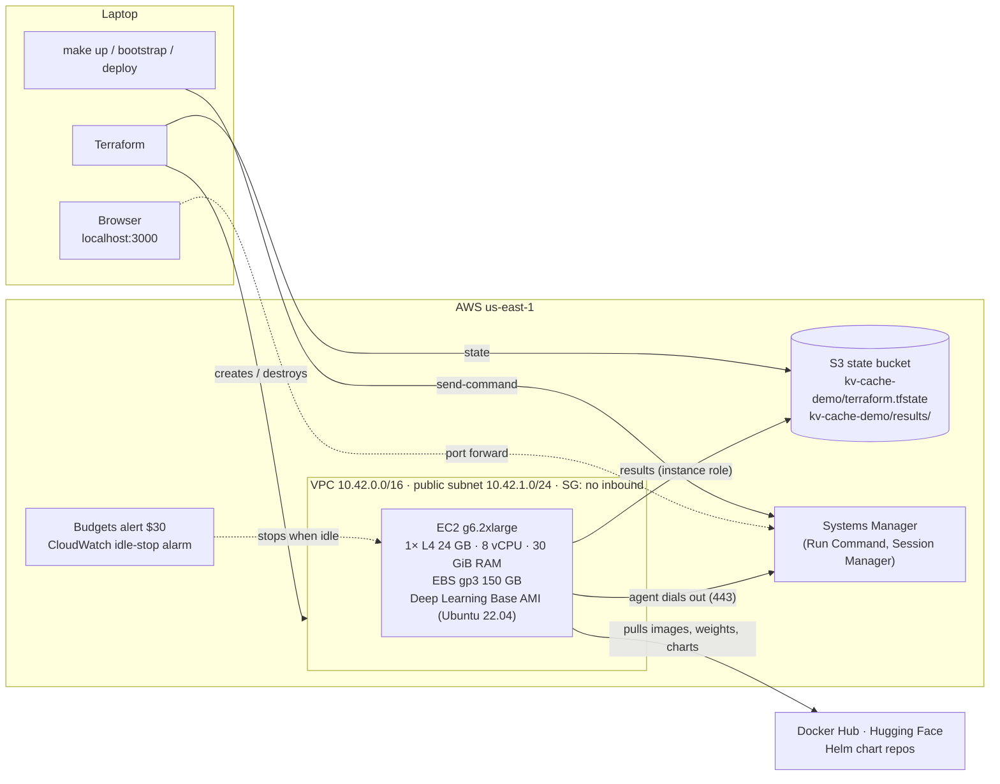
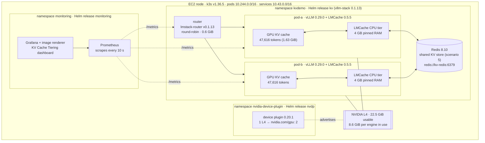

# Architecture

What is deployed, where each piece lives, and how to reach it. Numbers are measured on the running node (g6.2xlarge, Oct 4 2026) unless marked as estimates. The diagrams show scenario 5, the fullest configuration; scenarios 1–4 run pod-a alone, with no shared store (see [deploy/scenarios/](../deploy/scenarios/)).

## 1. AWS view

Everything runs on one GPU instance. Nothing accepts inbound connections; the laptop reaches the node through SSM, which the node's agent opens from the inside.



## 2. Inside the node

k3s runs a single-node Kubernetes cluster. The NVIDIA device plugin presents the one L4 as two schedulable GPUs (time-slicing). They share the GPU's compute and memory; each vLLM engine is capped at 0.4 of GPU memory.



## 3. Request path and KV lookup

On a request, vLLM looks for the prompt's KV in GPU memory first, then LMCache checks its local CPU tier, then the shared store. Only tokens found in none of them are recomputed (prefill). LMCache works in 256-token chunks (9.44 MB each for this model).

The shared store is Redis rather than the production-stack chart's own `lmcache_server`, which in LMCache 0.5.5 added ~3 s to every request and never served a hit ([REPORT.md, Appendix F](REPORT.md#appendix-f-the-charts-built-in-shared-cache-server-did-not-work)).

```mermaid
sequenceDiagram
  participant C as Client (bench job)
  participant R as Router
  participant V as vLLM pod
  participant L as LMCache CPU tier (same pod)
  participant S as Shared store (Redis)

  C->>R: completion (10K-token document + question)
  R->>V: forward (round-robin; scenarios 1-4 skip the router)
  V->>V: GPU prefix cache hit?
  alt in GPU memory
    V-->>C: first token (fast)
  else evicted or never seen here
    V->>L: lookup chunks
    alt in local RAM
      L-->>V: copy KV to GPU over PCIe
    else not local
      L->>S: lookup chunks
      S-->>L: KV if another pod stored it
    end
    V->>V: prefill only the missing tokens
    V-->>C: first token
    V->>L: store new KV chunks (and to the shared store)
  end
```

## 4. Where things live

The repo holds only our code and configuration. Charts, images, weights and cluster state are downloaded or created on the node at deploy time, pinned by version, and disappear with `make down`.

| What | Where | Size | Survives |
| --- | --- | --- | --- |
| Terraform, bootstrap, Helm values, scripts | This repo | small | always |
| Pinned versions | [deploy/versions.env](../deploy/versions.env), [bootstrap/node.sh](../bootstrap/node.sh) | — | always |
| Terraform state | `s3://<state bucket>/kv-cache-demo/terraform.tfstate` | KB | always |
| Benchmark results, Prometheus exports, rendered dashboards | `s3://<state bucket>/kv-cache-demo/results/`, and copies in [results/](../results/) and [docs/img/](img/) | MB | always |
| Helm **charts** | Not stored. Fetched by version from their repos on each deploy | — | — |
| Helm **binary** | Node: `/usr/local/bin/helm` (installed by bootstrap) | 50 MB | instance stop |
| Helm **release history** | Kubernetes Secrets `sh.helm.release.v1.*` in each namespace | KB | instance stop |
| Values shipped for a deploy | Node: `/opt/kvdemo/deploy/` (copied by `scripts/remote.sh -d`) | KB | instance stop |
| Container images | Node: `/var/lib/rancher/k3s/agent/containerd` | 45 GB | instance stop |
| Model weights | Node: `/var/lib/rancher/k3s/storage/` (one PVC per engine) | 12 GB | instance stop |
| Cluster state (etcd equivalent) | Node: `/var/lib/rancher/k3s/server/db` (SQLite) | 43 MB | instance stop |
| **KV cache** | GPU memory, pinned host RAM, Redis RAM (scenario 5) | GBs | nothing: gone on pod restart |

"Instance stop" means the data survives `make stop` / `make start` (the EBS volume is kept) but not `make down`, which deletes the volume.

The charts used:

| Release | Chart | Source |
| --- | --- | --- |
| `kv` | `vllm-stack` 0.1.13 | https://vllm-project.github.io/production-stack |
| `monitoring` | `kube-prometheus-stack` 91.9.0 | https://prometheus-community.github.io/helm-charts |
| `nvdp` | `nvidia-device-plugin` 0.20.1 | https://nvidia.github.io/k8s-device-plugin |

## 5. Resource budget (measured, both engines up)

| | GPU memory | Host RAM |
| --- | --- | --- |
| pod-a (weights + KV + CUDA graphs; process + 4 GB CPU tier) | 8.6 GiB | 7.3 GiB |
| pod-b | 8.6 GiB | 7.8 GiB |
| shared store (empty) | — | 0.4 GiB |
| router | — | 0.6 GiB |
| Prometheus + Grafana + exporters | — | 0.7 GiB |
| **Used / total** | **17.3 / 22.5 GiB** | **~17 / 30 GiB** |

## 6. How to reach it

| Want | Command | Needs |
| --- | --- | --- |
| Run a command on the node | `scripts/remote.sh '<cmd>'` | AWS CLI |
| Interactive shell | `make ssh` | session-manager-plugin |
| Grafana | `make grafana`, then http://localhost:3000 | session-manager-plugin |
| Save metrics and annotations before stopping | `make snapshot` | AWS CLI |
| GPU check | `make gpu` | AWS CLI |
