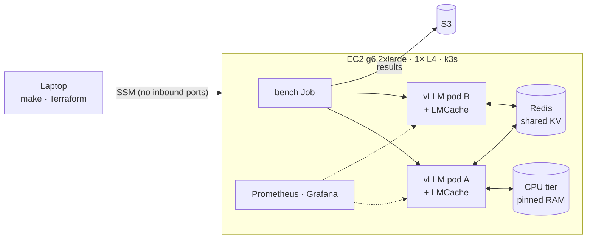
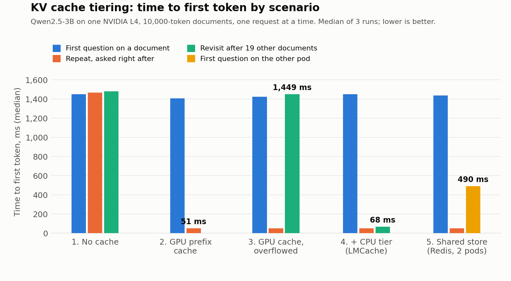
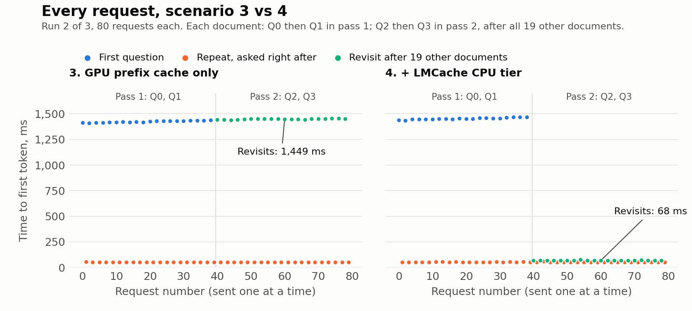
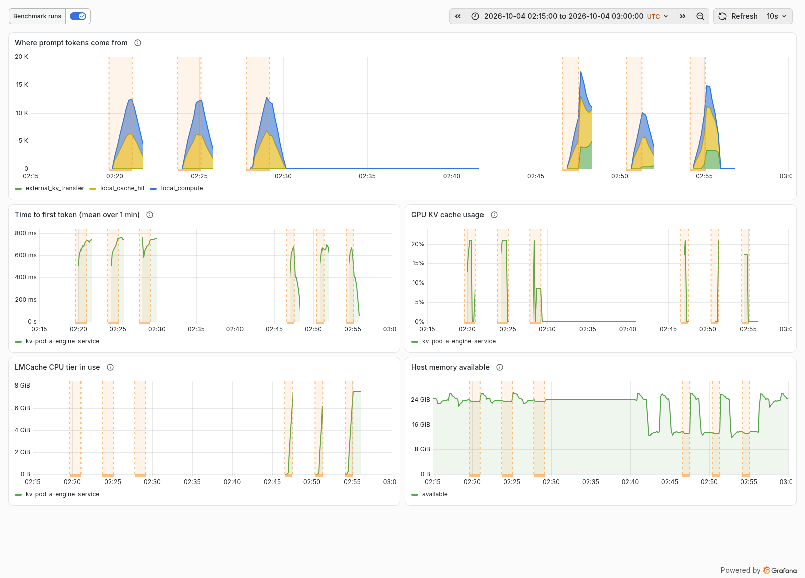
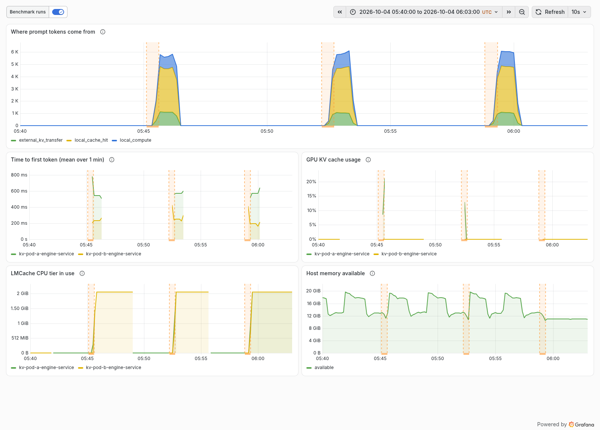
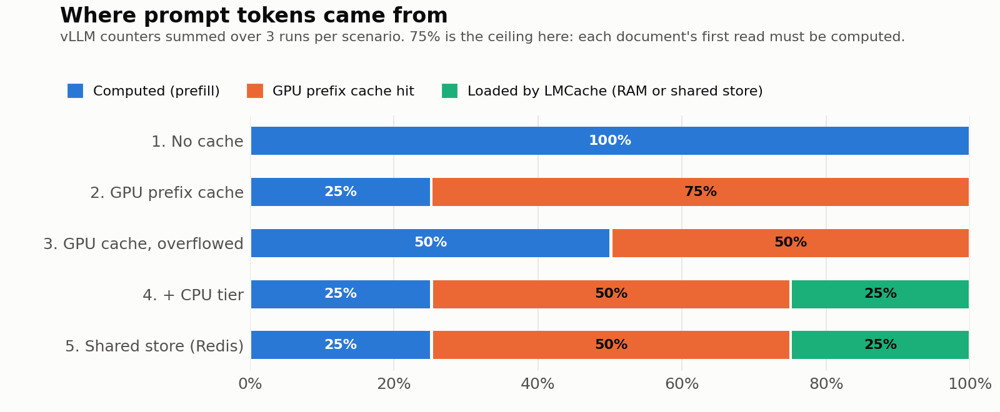
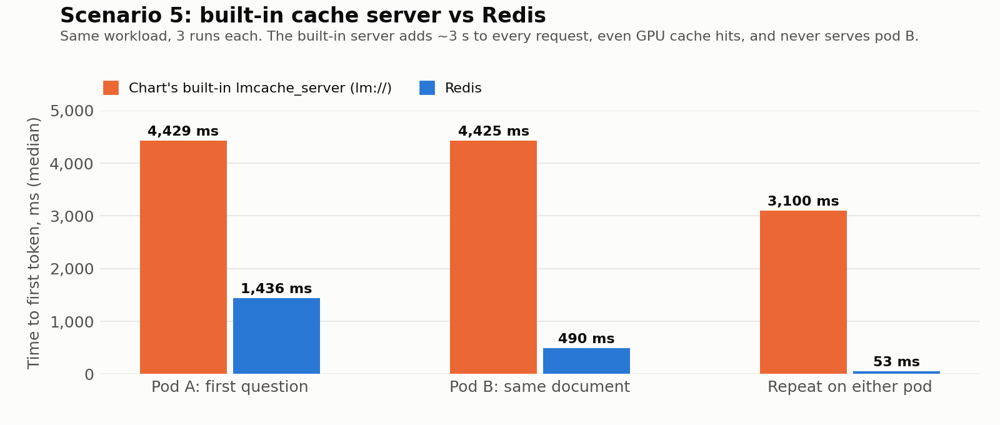

# Tiered and Shared KV Cache on a Single GPU: A Measured Study of Time-to-First-Token

*Pratik Kulkarni · October 2026 · Measurements taken 4 October 2026 on AWS us-east-1*

---

## Abstract

Prefill, computing the key/value (KV) vectors for every prompt token, dominates time-to-first-token (TTFT) for long prompts. GPU prefix caching avoids repeated prefill, but GPU memory holds only a few long prompts' worth of KV, so reuse collapses once the working set outgrows it. We measure, on one NVIDIA L4 with Qwen2.5-3B-Instruct, vLLM 0.29.0 and LMCache 0.5.5, how much a host-memory KV tier and a KV store shared across engines recover.

With 20 documents of 10,000 tokens in rotation (4× the GPU's KV capacity), revisiting an evicted document costs **1,449 ms** with GPU caching alone and **67.7 ms** with a 10 GB LMCache CPU tier, **21.4× faster**. Across the workload, the share of prompt tokens served from cache rises from 49.9% to 74.8% (the ceiling for this workload), **halving prefill compute** (72.6 → 36.5 L4 GPU-seconds per million prompt tokens). A second engine reusing the first engine's KV through a shared Redis store reaches first token in **490 ms instead of 1,436 ms (2.9×)**, limited by Redis's ~0.84 GB/s transfer rate against ~24 GB/s for the local PCIe tier.

GPU and CPU-tier measurements are reproducible to within 3% across independent runs, and an independent rerun from a fresh clone on a different GPU reproduced the headline to within 0.1%.

---

## 1. Introduction

An LLM request runs in two phases. **Prefill** processes the whole prompt in parallel and produces a key and a value vector per token per layer: the KV cache. **Decode** then generates output tokens one at a time, reading that cache. For long prompts, prefill sets TTFT, and its cost grows at least linearly with prompt length.

Many real workloads reuse long prefixes: document Q&A, retrieval-augmented generation, agents with large system prompts, multi-turn chat. If a prefix's KV still exists, prefill for it can be skipped. vLLM's automatic prefix caching does this within GPU memory. The limitation is capacity: on a 24 GB GPU running a 3B model, KV for under five 10K-token prompts fits alongside the weights. Once more distinct prefixes are in play, the cache evicts entries that will be needed again, and their prefill is paid again.

Two remedies are studied here:

- **A host-memory tier.** Evicted KV is kept in CPU RAM, which is far larger, and copied back to the GPU over PCIe when needed (LMCache's local CPU backend).
- **A shared tier.** KV computed by one inference engine is stored where another engine can load it (an LMCache remote backend).

This study asks how much each remedy recovers, measured end to end on real hardware with a reproducible setup, and what breaks along the way.

## 2. Background: how big is the KV cache?

For Qwen2.5-3B-Instruct (36 layers, 2 KV heads, head dimension 128, bf16), each token's KV occupies

> 2 (K and V) × 36 layers × 2 heads × 128 dims × 2 bytes = **36,864 bytes per token**.

A 10,000-token document therefore needs **~369 MB** of KV. LMCache moves KV in 256-token chunks of 9,437,184 bytes, which confirms the per-token figure (Section 5.4).

The L4 has 22.5 GiB usable. Each vLLM engine is capped at 40% of it (`gpu_memory_utilization=0.4`), about 9 GiB. After ~6.2 GiB of weights, CUDA graphs and activation workspace, vLLM reported **1.63 GiB of KV cache: 47,616 tokens**, or 4.75 documents.

## 3. System

### 3.1 Hardware and software

| Component | Detail |
| --- | --- |
| Instance | AWS g6.2xlarge: 1× NVIDIA L4 (22.5 GiB usable, PCIe Gen4), 8 vCPU, 30 GiB RAM, us-east-1a |
| OS / driver | Deep Learning Base OSS Nvidia Driver GPU AMI (Ubuntu 22.04), driver 595.91.07, CUDA 13.2 |
| Orchestration | k3s v1.36.5+k3s1 (single node); NVIDIA device plugin 0.20.1 with 2 time-slices; Helm v3.22.0 |
| Serving | vLLM production-stack chart 0.1.13; engine image `lmcache/vllm-openai:v0.5.5` (vLLM 0.29.0, LMCache 0.5.5, PyTorch 2.13.0+cu130); router `lmcache/lmstack-router:v0.1.13` |
| Model | `Qwen/Qwen2.5-3B-Instruct` at revision `aa8e72537993ba99e69dfaafa59ed015b17504d1` |
| Shared store | `redis:8.10.2-alpine`, no persistence, 3 GB max memory |
| Monitoring | kube-prometheus-stack 91.9.0 (Prometheus scraping every 10 s, Grafana with image renderer) |

### 3.2 Deployment



*Figure 1. Deployment. Scenarios 1–4 run pod A alone; scenario 5 runs both pods and Redis.*

Terraform creates a dedicated VPC, a security group with no inbound rules, an IAM role limited to Systems Manager and one S3 prefix, the instance, a budget alert and an idle-stop alarm. A bootstrap script installs k3s and the GPU plugin. Each scenario is a small overlay on one set of Helm values ([deploy/scenarios/](../deploy/scenarios/)). Engines use the `Recreate` update strategy and start one at a time, because vLLM sizes its KV cache from GPU memory that is free at startup. Full detail: [ARCHITECTURE.md](ARCHITECTURE.md).

## 4. Method

### 4.1 Workload

The workload is synthetic and seeded (seed 42): fake project reports built from a fixed vocabulary, each trimmed to **exactly 10,000 tokens** with the model's own tokenizer, plus four short questions per document (~23 tokens each). Prompts are sent to vLLM **as token IDs**, not text, so every question's prompt begins with byte-identical document tokens. A text prompt can tokenize differently where document and question meet, which would silently break prefix matching.

Requests go **one at a time**, so TTFT measures prefill rather than time spent queueing. Each request asks for 4 output tokens at temperature 0, with streaming on; TTFT is the time until the first streamed token arrives.

### 4.2 Request order

For *N* documents:

- **Pass 1:** for each document, Q0 then Q1 immediately after.
- **Pass 2:** for each document, Q2 then Q3.

Q1 and Q3 repeat a document that was just read. Q2 revisits a document after all *N*−1 others have been read (190K other tokens when *N* = 20, four times the GPU KV capacity).

### 4.3 Request types

Before sending, each request is labelled with what the GPU cache *should* do, by simulating an LRU cache whose size comes from vLLM's own `cache_config_info` metric (47,616 tokens):

| Type | Meaning |
| --- | --- |
| `first` | The document hasn't been seen in this run |
| `resident` | Its KV should still be in GPU memory |
| `evicted` | Enough other tokens have passed through since its last use to push it out |
| `cross` | (Scenario 5) the second engine's first request for a document the first engine has read |

The labels are checked against vLLM's per-request `cached_tokens` (enabled with `--enable-prompt-tokens-details`). In scenario 3, every `resident` request reported exactly 10,000 cached tokens, and every `first` and `evicted` request reported 0.

### 4.4 Scenarios

| # | Engines | vLLM prefix cache | LMCache | Shared store | Documents |
| --- | --- | --- | --- | --- | --- |
| 1 | pod A | off | off | — | 20 |
| 2 | pod A | on | off | — | 4 (fits in GPU) |
| 3 | pod A | on | off | — | 20 |
| 4 | pod A | on | CPU tier, 10 GB | — | 20 |
| 5 | pod A + pod B | on | CPU tier, 4 GB each | Redis | 4 |

In scenario 5, each document goes A → B → B → A: Q0 on pod A (`first`), Q1 on pod B (`cross`), Q2 on pod B and Q3 on pod A (`resident`).

### 4.5 Procedure and statistics

Each scenario is deployed from its overlay and then run **three times**. Before every run, all caches are emptied by restarting the shared store (if any) and then each engine in turn. Each run first sends a **warm-up** of 2 documents generated from a different seed, so CUDA graphs and kernels are warm but no measured document is cached. Per run we record every request's TTFT, its `cached_tokens`, and the change in every vLLM and LMCache counter.

We report, per scenario and request type, the **median of the three runs' medians** (p50), and the p90 likewise. Spread is (max − min) / min of the three run medians. All per-run figures are in Appendix A.

## 5. Results



*Figure 2. Median TTFT by scenario and request type (median of 3 runs).*

| # | Scenario | First | Repeat | Revisit (evicted) | Cross-pod |
| --- | --- | --- | --- | --- | --- |
| 1 | No caching | 1,451.8 | 1,468.4 | 1,481.4 | — |
| 2 | GPU prefix cache, 4 docs | 1,407.3 | **51.1** | — | — |
| 3 | GPU prefix cache, 20 docs | 1,424.7 | 51.8 | **1,449.2** | — |
| 4 | + LMCache CPU tier | 1,451.1 | 52.3 | **67.7** | — |
| 5 | Two engines + Redis | 1,436.2 | 52.8 | — | **490.1** |

*Table 1. TTFT p50 in ms. p90 values are in Appendix A and lie within 6% of p50, except cross-pod (up to 24%).*

### 5.1 Scenario 1: the cost of prefill

With no caching, every request costs ~1.45 s regardless of type. 10,023 tokens in 1.452 s is **~6,900 prompt tokens per second**. A rough check: the model's ~3.1 B parameters need about 2 × 3.1 B FLOPs per token (~62 TFLOP for the prompt), plus ~15 TFLOP of causal attention at this length. That's ~77 TFLOP in 1.45 s, about **53 TFLOPS sustained**, ~44% of the L4's dense bf16 peak (~121 TFLOPS). This is the cost every later scenario tries to avoid. vLLM's counters show 0 cached tokens across all 240 requests.

### 5.2 Scenario 2: GPU prefix caching when everything fits

With four documents (40K tokens, under the 47.6K capacity), every repeat is served from GPU memory. **TTFT falls from ~1,407 ms to 51.1 ms (27.5×)**: only the ~23 question tokens are computed, and the rest is scheduling and HTTP overhead. Counters: 120,000 GPU cache-hit tokens per run, exactly 12 repeats × 10,000. That's 74.8% of prompt tokens, the most possible here, since each document's first read must be computed.

### 5.3 Scenario 3: the GPU cache under pressure

With 20 documents, repeats asked straight away still hit (51.8 ms). But **Q2, asked after the other 19 documents, takes 1,449 ms, as long as a first read**. Its KV was evicted, and `cached_tokens` is 0 on all 60 such requests (20 per run × 3 runs). GPU cache hits fall to 49.9% of prompt tokens (400,000 of 801,808 per run): one in every two prompt tokens is recomputed, and half of that recomputation is for documents the GPU had already processed.



*Figure 3. Every request of run 2, in send order. In scenario 3, pass-2 revisits (green) cost as much as first reads; in scenario 4 they drop to the floor.*

### 5.4 Scenario 4: a CPU memory tier

With LMCache keeping KV in 10 GB of pinned host RAM, **revisits take 67.7 ms instead of 1,449 ms (21.4× faster)**, with a 0.1% spread across runs. The counters show the mechanism:

- vLLM reports **199,680 externally loaded tokens per run** in all three runs: 20 revisits × 9,984 tokens, i.e. 39 full 256-token chunks per document. The last 16 document tokens and the question are recomputed, because LMCache stores only full chunks.
- **0 evictions** from the CPU tier; the tier peaked at **8.10 GB**. That's 20 measured documents (7.36 GB) plus the 2 warm-up documents (0.74 GB).
- Prompt tokens served from cache rise to **74.8%**, the ceiling.

**Transfer rate.** A revisit costs 15.4 ms more than a GPU hit (67.7 vs 52.3 ms) to move 368 MB from host RAM to the GPU: **~24 GB/s**, about 75% of PCIe Gen4 ×16's theoretical 32 GB/s.

**Write-side cost.** First reads are 26 ms slower than in scenario 3 (1,451.1 vs 1,424.7 ms, +1.9%). That's consistent with LMCache copying each new document's KV out to host RAM on the request path. Engine logs showed ~43 ms per 10K-token store, partly overlapped with other work.



*Figure 4. Grafana during scenarios 3 (left three runs) and 4 (right three runs). Top: prompt tokens by source (blue: computed; yellow: GPU cache hit; green: loaded by LMCache). Bottom left: the CPU tier filling to ~7.5 GiB in each scenario 4 run. Shaded bands mark the benchmark runs.*

### 5.5 Scenario 5: sharing KV across engines

The shared store is Redis rather than the production-stack chart's built-in LMCache cache server, which did not work in this version: it added ~3 s to every request and never served a hit (Appendix F).

Pod A reads each document first (1,436 ms). Pod B then asks about the same document. It has never seen it, but it loads the KV from Redis, where pod A's LMCache stored it: **490 ms instead of 1,436 ms (2.9×)**. Pod B reports 39,936 externally loaded tokens per run (4 documents × 9,984) and `cached_tokens` = 9,984 on every cross request. Repeats on either pod stay at ~53 ms.

Cross-pod reuse is slower and noisier than the local tier. Moving 368 MB in ~437 ms (490 − 53) is **~0.84 GB/s**, about 28× slower than PCIe. Redis is single-threaded and the data goes through TCP and a Python client. The three runs' medians ranged from 378 to 537 ms (42% spread), against ≤ 3% everywhere else. That gap, between where a shared tier is today and where the local tier already is, is what a purpose-built shared KV memory layer is meant to close.



*Figure 5. Grafana during the three scenario 5 runs. Green: KV loaded from Redis by pod B. Pod B's mean TTFT (yellow, middle left) stays well below pod A's.*

### 5.6 Where prompt tokens came from



*Figure 6. Share of prompt tokens computed versus served from each cache (vLLM counters, 3 runs per scenario).*

### 5.7 Prefill compute and cost

At the measured ~6,900 tokens/s, prefill costs **145 L4 GPU-seconds per million prompt tokens prefilled**. Per million prompt tokens of this workload:

| Scenario | Prompt tokens computed | Prefill GPU-seconds | Prefill cost at $0.9776/h |
| --- | --- | --- | --- |
| 1. No cache | 100% | 144.9 | $0.039 |
| 3. GPU cache, 20 docs | 50.1% | 72.6 | $0.020 |
| 4. + CPU tier | 25.2% | 36.5 | $0.010 |

The CPU tier cuts prefill compute by **49.7%** compared with GPU caching alone. The dollar figures are small because the model is small. Prefill cost grows roughly with parameter count, so the same workload on a 70B-class model would save roughly 20× more per token (an extrapolation, not measured here). The saving also grows with prefix length and reuse rate.

### 5.8 Reproducibility

Every GPU and CPU-tier measurement agrees across the three independent runs to within **3%**, and to within **1.5%** outside scenario 1 (Appendix A). Two small systematic effects show in the per-request data:

- **TTFT creeps up through a run.** In Figure 3, first reads rise from ~1,410 to ~1,440 ms over 40 requests. Scenario 1, with no caching at all, shows the same pattern (first 1,452 → revisit 1,481 ms), so the creep isn't a cache effect. A gradual GPU clock reduction under the L4's 72 W power limit, or thermally, would explain it. GPU clocks weren't recorded, so this is a hypothesis. It also accounts for most of the ~25 ms by which scenario 3's revisits (sent later) exceed its first reads.
- **Scenario 1 varies more between runs (up to 2.7%)** than the cached scenarios, again consistent with a GPU-speed effect, since it's the only scenario where every request is pure prefill.

### 5.9 Independent reproduction

To test the claim that the setup reproduces from its documentation alone, the whole study was rerun the same day from a **fresh clone of the GitHub repository**: a new instance (a different physical L4), `make up`, `bootstrap`, `deploy`, all five scenarios × 3 runs, `snapshot`. Every step succeeded on the first attempt. The only deviation from the README was writing results to `results/repro/`, to keep the original runs intact. The data is in [results/repro/](../results/repro/).

| Scenario | Type | Original (ms) | Reproduction (ms) | Difference |
| --- | --- | --- | --- | --- |
| 1. No cache | first / repeat / revisit | 1,451.8 / 1,468.4 / 1,481.4 | 1,414.5 / 1,427.7 / 1,439.2 | −2.6% / −2.8% / −2.9% |
| 2. GPU prefix cache | repeat | 51.1 | 50.8 | −0.7% |
| 3. GPU cache, overflowed | repeat / revisit | 51.8 / 1,449.2 | 51.8 / 1,415.8 | −0.2% / −2.3% |
| **4. + CPU tier** | **revisit** | **67.7** | **67.6** | **−0.1%** |
| 5. Shared store (Redis) | cross-pod | 490.1 | 443.9 | −9.4% |

*Table 2. Original versus reproduction, median of 3 runs each.*

Requests served from cache (GPU hits, CPU-tier loads) reproduced to within 0.7%. Pure prefill ran 1.4–2.9% faster on the second GPU, as expected for a compute-bound path on a different unit. The cross-pod result falls inside the original's own run-to-run range (378–537 ms). The share of prompt tokens served from cache matched exactly in every scenario (0%, 74.8%, 49.9%, 74.8%, 74.8%). The headline speedup was 20.9× (vs 21.4×).

## 6. Discussion

**What the numbers mean for a serving system.** GPU prefix caching is very effective (27×) but fragile: it holds only while the working set fits in a few GiB of HBM. In this workload, working sets 4× larger than GPU capacity turned half of all prompt tokens back into prefill. A host-memory tier recovers nearly all of that for a ~16 ms copy per 10K-token prefix. Host RAM is plentiful and cheap compared with HBM, so this is the obvious next tier. The write-side cost (+1.9% on first reads) is small.

**Sharing across engines** extends reuse beyond one GPU: a replica that has never seen a prefix can still skip most of its prefill. Here the benefit (2.9×) was capped by the transport, not by the idea. The local tier moves KV ~28× faster than Redis did, so a shared tier with near-local bandwidth would bring cross-engine reuse close to the 68 ms of the local tier. Shared-tier performance is mostly a data-movement problem.

**Threats to validity.**
- **One request at a time.** This isolates prefill cost but doesn't show effects under concurrency, where caching also frees GPU time for other requests and improves throughput and tail latency.
- **A synthetic workload with a designed access order.** Real reuse patterns are less regular. The order here was chosen to make eviction certain, and the results show the mechanism, not a production hit rate.
- **A small model on one GPU.** "Cross-pod" traffic stayed on one machine. With two nodes, network transport would dominate the shared tier.
- **Time-slicing.** The two engines share one GPU. With one request at a time they never computed simultaneously, so there was no contention, but this isn't a representation of two independent GPUs.
- **Counters.** LMCache's own hit counter (`lmcache:num_hit_tokens_total`) lagged vLLM's and varied between identical runs (119,808–149,760 per run in scenario 4, against vLLM's constant 199,680). All claims here use vLLM's counters and the per-request `cached_tokens`.

## 7. Conclusion and future work

On one L4 with a 3B model, a host-memory KV tier turned an evicted 10K-token prefix's TTFT from 1,449 ms into 67.7 ms (21.4×) and halved prefill compute for a workload four times larger than GPU KV capacity. Cross-engine sharing through Redis cut a cold replica's TTFT by 2.9×, limited by transport bandwidth. An independent rerun from a fresh clone on a different GPU reproduced every result: cache-served latencies within 0.7%, the headline at 67.6 vs 67.7 ms, and identical cache-hit shares.

Next steps, in order of how much they would add:
1. **Two nodes,** so the shared tier crosses a real network and transport choices (TCP, RDMA/EFA) can be compared.
2. **A 70B-class model,** where each avoided prefill is ~20× more expensive.
3. **Concurrent load,** to measure throughput and tail-latency effects.
4. **Pin down the built-in cache server failure** (Appendix F) and report it upstream.

---

## Appendix A. Per-run results

TTFT in ms. "n/run" is the number of requests of that type per run.

| Scenario | Type | n/run | Run 1 p50 | Run 2 p50 | Run 3 p50 | **Median** | Spread | Run 1 p90 | Run 2 p90 | Run 3 p90 |
| --- | --- | --- | --- | --- | --- | --- | --- | --- | --- | --- |
| s1-no-cache | first | 20 | 1,418.2 | 1,451.8 | 1,454.9 | **1,451.8** | 2.6% | 1,437.1 | 1,470.9 | 1,476.8 |
| s1-no-cache | resident | 40 | 1,437.1 | 1,468.4 | 1,475.7 | **1,468.4** | 2.7% | 1,463.6 | 1,484.7 | 1,487.3 |
| s1-no-cache | evicted | 20 | 1,454.2 | 1,481.4 | 1,481.8 | **1,481.4** | 1.9% | 1,465.4 | 1,488.0 | 1,486.5 |
| s2-gpu-cache | first | 4 | 1,407.3 | 1,408.9 | 1,405.8 | **1,407.3** | 0.2% | 1,409.6 | 1,410.8 | 1,407.8 |
| s2-gpu-cache | resident | 12 | 51.1 | 51.3 | 50.6 | **51.1** | 1.4% | 51.8 | 52.0 | 51.9 |
| s3-gpu-pressure | first | 20 | 1,408.5 | 1,424.7 | 1,427.1 | **1,424.7** | 1.3% | 1,420.6 | 1,434.1 | 1,436.6 |
| s3-gpu-pressure | resident | 40 | 51.5 | 52.0 | 51.8 | **51.8** | 1.0% | 52.1 | 53.4 | 53.0 |
| s3-gpu-pressure | evicted | 20 | 1,430.3 | 1,449.2 | 1,450.8 | **1,449.2** | 1.4% | 1,440.3 | 1,454.9 | 1,461.1 |
| s4-cpu-tier | first | 20 | 1,441.2 | 1,451.1 | 1,454.9 | **1,451.1** | 1.0% | 1,449.1 | 1,468.5 | 1,469.9 |
| s4-cpu-tier | resident | 40 | 52.1 | 52.7 | 52.3 | **52.3** | 1.1% | 53.1 | 54.0 | 53.2 |
| s4-cpu-tier | evicted | 20 | 67.7 | 67.6 | 67.7 | **67.7** | 0.1% | 68.6 | 71.1 | 69.6 |
| s5-shared | first | 4 | 1,434.4 | 1,438.1 | 1,436.2 | **1,436.2** | 0.3% | 1,439.8 | 1,441.9 | 1,436.7 |
| s5-shared | resident | 8 | 52.8 | 52.2 | 53.0 | **52.8** | 1.6% | 54.2 | 53.9 | 55.7 |
| s5-shared | cross | 4 | 490.1 | 537.3 | 378.3 | **490.1** | 42.0% | 608.1 | 555.4 | 395.2 |
| bug-s5-lmserver | first | 4 | 4,421.4 | 4,428.6 | 4,429.2 | **4,428.6** | 0.2% | 4,426.1 | 4,431.5 | 4,430.3 |
| bug-s5-lmserver | resident | 8 | 3,099.8 | 3,099.5 | 3,098.6 | **3,099.5** | 0.0% | 3,101.4 | 3,102.6 | 3,100.4 |
| bug-s5-lmserver | cross | 4 | 4,424.7 | 4,426.6 | 4,418.9 | **4,424.7** | 0.2% | 4,427.2 | 4,431.8 | 4,424.4 |

p90 is nearest-rank, so with 4 requests per run it is the slowest request.

## Appendix B. Counter evidence per run

Changes in vLLM counters over each run's measured requests (warm-up excluded), summed across engines in scenario 5.

| Scenario | Prompt tokens | GPU prefix-cache hit tokens | LMCache-loaded tokens | Requests |
| --- | --- | --- | --- | --- |
| s1-no-cache (each run) | 801,808 | 0 | 0 | 80 |
| s2-gpu-cache (each run) | 160,368 | 120,000 | 0 | 16 |
| s3-gpu-pressure (each run) | 801,808 | 400,000 | 0 | 80 |
| s4-cpu-tier (each run) | 801,808 | 400,000 | 199,680 | 80 |
| s5-shared (each run) | 160,368 | 80,000 | 39,936 | 16 |
| bug-s5-lmserver (each run) | 160,368 | 80,000 | 0 | 16 |

Every value was identical across the three runs of its scenario. Raw data: `results/<scenario>/run*.json` (`counter_delta`).

## Appendix C. Run schedule

All times UTC on 4 October 2026, from the benchmark Jobs ([results/metrics/run_windows.csv](../results/metrics/run_windows.csv)). Each run's caches were reset in the minutes before it started.

| Scenario | Run 1 | Run 2 | Run 3 |
| --- | --- | --- | --- |
| s3-gpu-pressure | 02:19:39–02:21:02 | 02:23:43–02:25:07 | 02:27:48–02:29:11 |
| s4-cpu-tier | 02:46:35–02:47:32 | 02:50:23–02:51:19 | 02:54:10–02:55:06 |
| s1-no-cache | 03:01:42–03:04:09 | 03:06:50–03:09:19 | 03:12:00–03:14:30 |
| s2-gpu-cache | 03:20:30–03:20:55 | 03:23:36–03:24:00 | 03:26:41–03:27:06 |
| s5-shared (Redis) | 05:45:07–05:45:37 | 05:52:13–05:52:43 | 05:58:50–05:59:21 |

The broken-server runs (bug-s5-lmserver) ran directly after scenario 2, roughly 03:30–03:50 (estimated). Their Job records were overwritten when scenario 5 was rerun, and their S3 timestamps reflect a later move, so exact windows aren't available.

## Appendix D. Measurement-validity checks

Two defects in the benchmark itself were found and fixed before the results above were produced. Either would have biased the numbers without producing an error:

| Defect | Effect if it had gone unnoticed | Fix |
| --- | --- | --- |
| The pre-run cache reset selected the shared store by a label that didn't match its pods, so it silently skipped it | KV from one run would survive into the next, making later runs look faster than they were | Correct label; the reset now restarts the shared store first, then each engine in turn |
| p50 was computed as a nearest-rank percentile, which for an even number of samples picks the upper of the two middle values | With 4 cross-pod requests per run, the scenario 5 result was overstated by 17 ms (507 vs 490 ms) | p50 uses a true median; p90 stays nearest-rank |

## Appendix E. Reproducing this report

All numbers and figures are produced from the files in [results/](../results/):

```bash
make results     # fetch run CSVs, counters and Prometheus exports from S3
make report      # results/summary.md and every figure (2, 3, 6, F1)

```

Rerunning the experiments themselves takes ~2 hours of g6.2xlarge time (~$2); see the [README](../README.md#reproduce). This study used about 9 instance-hours in total (~$9): ~7 for the original session, including setup and debugging, and ~2 for the independent reproduction (§5.9).


## Appendix F. The chart's built-in shared cache server did not work

Scenario 5 was first run with the production-stack chart's built-in shared store (`cacheserverSpec`, which runs LMCache's standalone `lmcache_server`; engines connect with `LMCACHE_REMOTE_URL=lm://…`). This is the configuration from the chart's own tutorial on sharing KV across instances. In our setup it did not work, so scenario 5 uses Redis instead. The configuration is kept as [deploy/scenarios/bug-s5-lmserver.yaml](../deploy/scenarios/bug-s5-lmserver.yaml) and reruns with `make scenario S=bug`.



*Figure F1. Scenario 5 with the chart's built-in cache server versus Redis (3 runs each, same workload).*

**What was observed** (consistent across all 3 runs):
- Every request on both engines gained a near-constant **~3 s**: first reads 4,429 ms (vs 1,436 ms with Redis), and repeats **3,100 ms even though the GPU served them** (`cached_tokens` = 10,000; 53 ms with Redis).
- Pod B never received a token from the server: `vllm:external_prefix_cache_hits_total` stayed at 0, so cross-pod requests cost a full prefill plus the 3 s.
- Engine logs (pod B): **14×** `Timeout occurred for rank 0, recreating all sockets` from LMCache's internal lookup RPC (`zmq_transport.py`), and **once** `Remote connection failed in contains: unpack requires a buffer of 36 bytes`.

**What the code shows (LMCache v0.5.5).** On each request, LMCache's scheduler asks its worker, over an internal ZMQ socket, how much of the prompt is cached, and the worker asks the remote backend. The ~3 s matches that RPC timing out, which also explains why the delay hits pure GPU cache hits. The single `unpack` error comes from the `lm://` client: `exists()` reads the server's 36-byte reply (`ServerMetaMessage`, 9 ints) with one `recv()` call and no loop to read the rest, so a reply arriving in pieces fails to parse. Why the worker stops answering lookups in time was **not established**. Plausible causes, untested: the worker blocking on synchronous transfers to the server (each document is ~369 MB, received by a pure-Python server), or the single shared socket getting out of step after a short read.

**A diagnosis we ruled out.** Our initial diagnosis attributed the failure to a client/server mismatch in metadata header size (28 vs 36 bytes). A closer reading of the code showed that is wrong: the server's request handler never uses that metadata, and 36 bytes is the size of the server's reply, not of a header. The diagnosis above is limited to what the evidence supports.

**Related upstream reports.** The chart's liveness probe for this server, which runs a script missing from recent images, is already reported as vllm-project/production-stack #1057, with open fix PRs (#1058, #1065, #1114). We disabled the probe; the failure described here happens without it. The lookup timeouts themselves appear not to have been reported as of October 2026. LMCache also logs `remote_url is deprecated`, which suggests this path gets less attention than the newer `remote_storage_plugins` mechanism.
